<picture><source media="(max-width: 640px) and (prefers-color-scheme: dark)" srcset="assets/hero-phone-dark.svg"><source media="(max-width: 640px)" srcset="assets/hero-phone-light.svg"><source media="(prefers-color-scheme: dark)" srcset="assets/hero-dark.svg"></picture>

<picture><source media="(max-width: 640px) and (prefers-color-scheme: dark)" srcset="assets/about-phone-dark.svg"><source media="(max-width: 640px)" srcset="assets/about-phone-light.svg"><source media="(prefers-color-scheme: dark)" srcset="assets/about-dark.svg"></picture>

<a href="https://github.com/thealiarbab/StockSaathi"><picture><source media="(max-width: 640px) and (prefers-color-scheme: dark)" srcset="assets/stocksaathi-phone-dark.svg"><source media="(max-width: 640px)" srcset="assets/stocksaathi-phone-light.svg"><source media="(prefers-color-scheme: dark)" srcset="assets/stocksaathi-dark.svg"></picture></a>

<picture><source media="(max-width: 640px) and (prefers-color-scheme: dark)" srcset="assets/bolhisaab-phone-dark.svg"><source media="(max-width: 640px)" srcset="assets/bolhisaab-phone-light.svg"><source media="(prefers-color-scheme: dark)" srcset="assets/bolhisaab-dark.svg"></picture>

<a href="https://github.com/thealiarbab/SpendInCheck"><picture><source media="(max-width: 640px) and (prefers-color-scheme: dark)" srcset="assets/spendincheck-phone-dark.svg"><source media="(max-width: 640px)" srcset="assets/spendincheck-phone-light.svg"><source media="(prefers-color-scheme: dark)" srcset="assets/spendincheck-dark.svg"></picture></a>

<a href="https://github.com/thealiarbab/sovereign-alpha"><picture><source media="(max-width: 640px) and (prefers-color-scheme: dark)" srcset="assets/sovereign-alpha-phone-dark.svg"><source media="(max-width: 640px)" srcset="assets/sovereign-alpha-phone-light.svg"><source media="(prefers-color-scheme: dark)" srcset="assets/sovereign-alpha-dark.svg"></picture></a>

<a href="https://github.com/thealiarbab/MagLock-Protocol"><picture><source media="(max-width: 640px) and (prefers-color-scheme: dark)" srcset="assets/maglock-phone-dark.svg"><source media="(max-width: 640px)" srcset="assets/maglock-phone-light.svg"><source media="(prefers-color-scheme: dark)" srcset="assets/maglock-dark.svg"></picture></a>

<a href="https://aliarbab2009.com"><picture><source media="(prefers-color-scheme: dark)" srcset="assets/link-site-dark.svg"></picture></a>
<a href="https://x.com/thealiarbab"><picture><source media="(prefers-color-scheme: dark)" srcset="assets/link-x-dark.svg"></picture></a>
<a href="https://www.linkedin.com/in/thealiarbab"><picture><source media="(prefers-color-scheme: dark)" srcset="assets/link-linkedin-dark.svg"></picture></a>

The chart is drawn from my GitHub contributions and redrawn every day: weekly candles of the 4-week running total, on a square-root scale.

